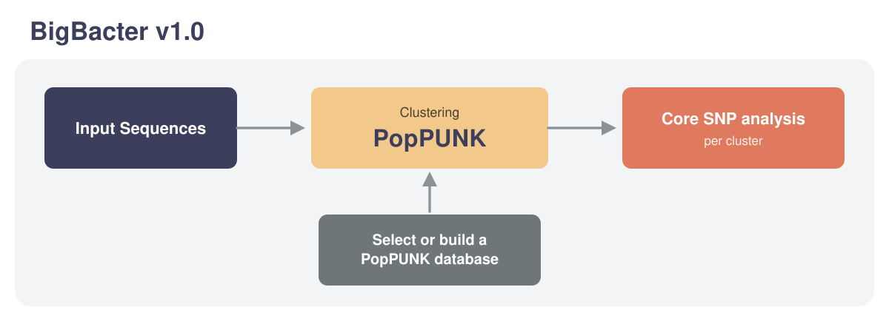
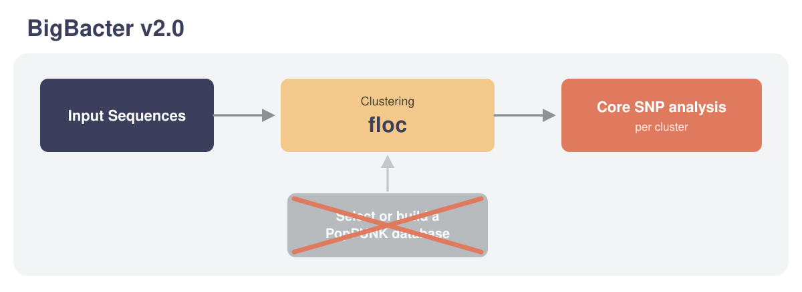
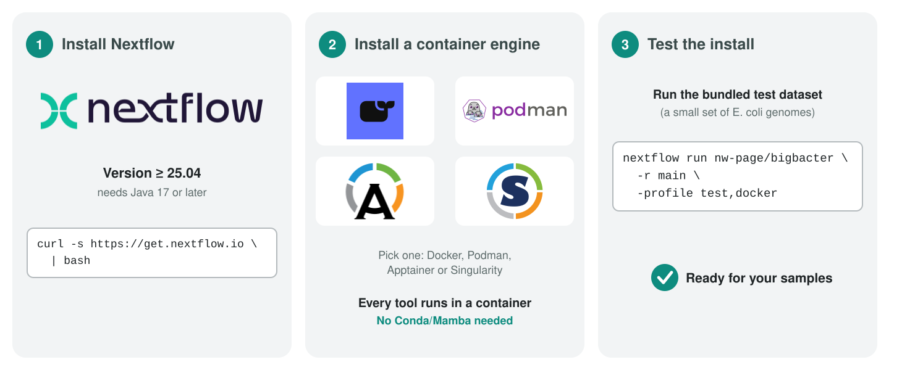
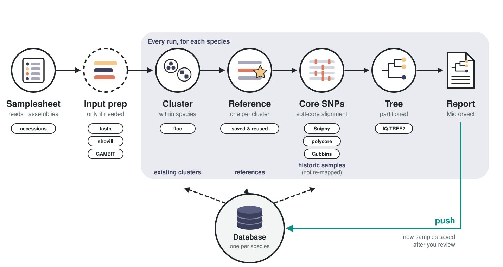
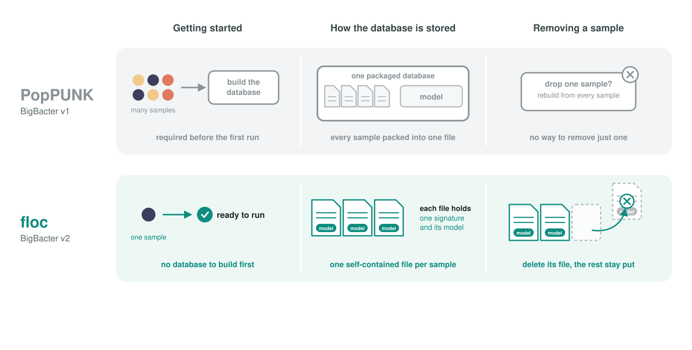
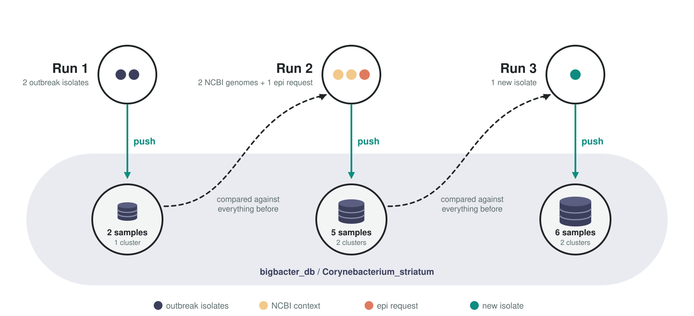
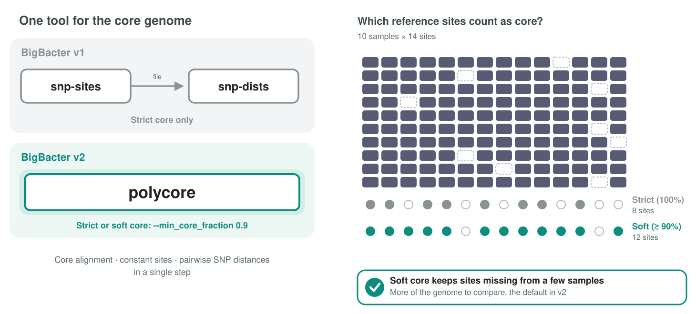

# Setting the stage

## Scenario: A suspected outbreak

::: {.lead}
Epis reach out about a suspected ***Corynebacterium striatum*** outbreak and ask the lab to use
whole genome sequencing to investigate.
:::

::: {.organism}
{.organism-icon fig-alt="Simplified drawing of club-shaped Corynebacterium rods"}

::: {.organism-text}
**About *C. striatum***

Skin and mucosal commensal, increasingly recognized as a multidrug-resistant,
healthcare-associated pathogen.
:::
:::

## Currently using BigBacter v1.0

{.title-logo fig-alt="BigBacter logo"}

::: {.lead}
The lab already uses BigBacter v1.0 ... but _C. striatum_ has never been analyzed before. 


**We will need to find a PopPUNK database for this species! ([available databases](https://bacpop.org/poppunk-databases/))**
:::

{fig-align="center" width="92%" fig-alt="BigBacter v1: many genomes of the species are used to build a PopPUNK database before the first run; only then can BigBacter v1 assign clusters and run the SNP analysis"}

## Upgrading to BigBacter v2

{.title-logo fig-alt="BigBacter logo"}

::: {.lead}
BigBacter v2 replaces PopPUNK with a new tool called, floc.

**Floc builds each database automatically - no pre-configuration required!**
:::

{fig-align="center" width="92%" fig-alt="BigBacter v2: one or more samples of any species go into BigBacter v2, floc clusters them on the fly, and the database is created automatically on push and grows with every run"}

# Run 1

## 1. Getting started with BigBacter

{fig-align="center" width="100%" fig-alt="Three steps: 1, install Nextflow version 25.04 or later with Java 17 or later; 2, install a container engine (Docker, Podman, Apptainer or Singularity); 3, test the install with nextflow run nw-page/bigbacter -r main -profile test,docker"}

## 2. Create the samplesheet

### Example:
```{.csv .code-overflow-wrap filename="samplesheets/samplesheet.1.csv"}
sample,taxa,assembly,fastq_1,fastq_2
sim01,Corynebacterium striatum,sim01.fasta.gz,sim01_R1.fastq.gz,sim01_R2.fastq.gz
sim02,Corynebacterium striatum,sim02.fasta.gz,sim02_R1.fastq.gz,sim02_R2.fastq.gz
```

### Description of fields:
:::: {.columns}
::: {.column width="50%"}
::: {.box .note title="Required"}
- `sample`: a unique name
- Data: reads (`fastq_1`/`fastq_2`), **or** an `sra` / `genbank` accession that BigBacter downloads
:::
:::
::: {.column width="50%"}
::: {.box .plain title="Optional"}
- `taxa` and `assembly`: **reuse outputs from your routine pipeline**
- Skips taxonomic classification and assembly
:::
:::
::::

## 3. Create the parameter file

### Example
```{.yaml filename="params/params.1.yml"}
input: samplesheets/samplesheet.1.csv
outdir: results
db: bigbacter_db/
push: false
```
### Description of fields
- `input`: path to samplesheet
- `outdir`: results for this run
- `db`: path to BigBacter database
- `push: false`: this will be updated later!

::: {.box .accent title="Tip"}
Parameter or config files are highly recommended for newer version of Nextflow!
:::

## 4. Run BigBacter

### Example
```bash
nextflow run nw-page/bigbacter \
    -r main \
    -profile docker,pc \
    -params-file params/params.1.yml
```

### Description of fields
- `-r main`: use main branch of `nw-page/bigbacter` repo
- `-profile docker,pc`: use the Docker engine and adjust resources for running on a PC
- `-params-file`: use the params file we created on the previous slide

::: {.box .plain .center}
⏱ Should take about 3 mins to complete
:::

# While that's running…

## How BigBacter works

{fig-align="center" width="100%" fig-alt="BigBacter pipeline: samplesheet, input prep, cluster with floc, select reference, core SNPs, tree, report; the database supplies existing clusters, references and historic samples and receives results on push"}

::: {.notes}
Reference: https://nw-page.github.io/bigbacter-docs/docs/v2.0/pages/overview/
Input prep is dashed: it only runs for what's missing (e.g. no assembly or no taxa in the samplesheet).
:::

## Clustering with floc

{.title-logo fig-alt="floc logo"}

:::{.lead}
Floc was designed as a **more flexible alternative to PopPUNK**. 
:::

{fig-align="center" width="100%" fig-alt="PopPUNK (BigBacter v1) needs a database built from many samples before the first run, packs every sample into one file and can't remove just one; floc (BigBacter v2) is ready to run with one sample, stores one self-contained file per sample, and removes a sample by deleting its file"}

- Databases are created **automatically** using a few as a **single sample**.
- Samples can be both added **and removed**.

# Run 1 results

## 5. Check the results

::: {.numbered-steps}
1. **Find the run.** Each run gets a run ID (a timestamp) and its own folder

   ```bash
   ls results/
   ```

2. **Open the run summary.** Which cluster did each sample land in, and how is it linked?

   ```bash
   results/<run ID>/<run ID>-summary.csv
   ```

3. **Open the Microreact report.** Drag it onto [microreact.org/upload](https://microreact.org/upload){target="_blank"}

   ```bash
   results/<run ID>/Corynebacterium_striatum/1/report/*.microreact
   ```

4. **Decide.** Happy with the results? Push them to the database
:::


## 6. Push the samples

:::{.lead}
We are happy with these results, which means we are ready to push them to our database.

**We can do this by resuming the previous BigBacter run with `push` set to `true`.**
:::

### Example
:::: {.columns .push-row}
::: {.column width="50%"}
```{.yaml filename="params/params.1.yml"}
input: samplesheets/samplesheet.1.csv
outdir: results
db: bigbacter_db/
push: true
```
:::
::: {.column width="50%"}
```bash
nextflow run nw-page/bigbacter -r main \
  -profile docker,pc \
  -params-file params/params.1.yml \
  -resume
```
:::
::::

### Description of fields
- `-resume`: reuses the cached work, so **nothing is recomputed**.
- `push: true`: push new files to the BigBacter database

::: {.box .plain .center}
⏱ Should take < 30 seconds
:::

## The database grows with every run

{fig-align="center" width="100%" fig-alt="Three runs each push into the C. striatum database, which grows from 2 to 5 to 6 samples; each run is compared against everything already in the database"}

::: {.notes}
This is the arc of the rest of the demo: run 1 (outbreak isolates), run 2 (NCBI context + epi request),
run 3 (one new isolate).
:::

# Run 2: adding contextual samples

## NCBI Pathogen Detection

:::{.lead}
We decide to submit one of the samples to NCBI and request it be added to the [Pathogen Detection site](https://www.ncbi.nlm.nih.gov/pathogens/).

This reveals two closely related genomes from a different lab!

**We want to add these samples to our BigBacter database...**
:::

::: {.notes}
Optional: open NCBI Pathogen Detection and show where the accessions came from.
:::

## Epi request

:::: {.columns}

::: {.column width="50%"}

:::

::: {.column width="50%" .dan}
One of the genomic epis, **Dan**, is certain he has found an additional linkage on NCBI and has requested you include it...


...sure thing, Dan! 🙄
:::

::::

## Create the samplesheet (again)

### Example
```{.csv filename="samplesheets/samplesheet.2.csv"}
sample,taxa,genbank
PD1,Corynebacterium striatum,GCA_016085355.1
PD2,Corynebacterium striatum,GCA_002804085.1
Dan_Sample,Corynebacterium striatum,GCA_015946805.1
```
### Description of fields
- `sample / taxa`: the same as before
- `genbank`: GenBank accession

:::{.tip}
BigBacter automatically downloads assemblies and reads from NCBI when supplied GenBank or SRA accessions!
:::

## Run 2
:::{.lead}
Kick of the new run using the new samplesheet and params file!
:::

### Example
```bash
nextflow run nw-page/bigbacter -r main \
  -profile docker,pc \
  -params-file params/params.2.yml
```

::: {.box .plain .center}
⏱ Should take about 2 mins to complete
:::

# While that's running…

## Core genome with polycore

{fig-align="center" width="100%" fig-alt="BigBacter v1 used snp-sites then snp-dists for a strict core only; BigBacter v2 uses polycore for a strict or soft core. In an example of 10 samples by 14 sites, a strict core keeps 8 sites and a 90% soft core keeps 12"}

::: {.notes}
polycore builds the core alignment, constant sites and pairwise SNP distances in one step.
Default --min_core_fraction 0.9: a reference site is kept if it's covered in at least 90% of samples.
Samples already in the database aren't re-mapped: their per-sample variant files are reused.
:::

## Reading the tree: linkage

{fig-align="center" width="100%" fig-alt="Tree where samples A and B are 6 SNPs apart (strong link, 10 SNPs or fewer), C is about 33 SNPs from them (intermediate link, 11 to 50 SNPs), and D is more than 100 substitutions away in a separate partition"}

::: {.notes}
These are BigBacter defaults, not outbreak definitions for C. striatum. Agree on thresholds with epis.
:::

## Run 2 results

| id | status | cluster | strong links | SNPs (min–max) |
|---|---|---|---|---|
| GCA_002804085_1 | new | 1 | GCA_016085355_1, sim01, sim02, Reference_sim02 | 1–10 |
| GCA_016085355_1 | new | 1 | GCA_002804085_1 | 10–20 |
| sim01 | old | 1 | GCA_002804085_1 | 10–20 |
| sim02 | old | 1 | GCA_002804085_1, Reference_sim02 | 1–11 |
| **Dan_Request** | new | **2** | – | – |

- **GCA_002804085_1** is **1 SNP** from sim02: a public genome closely linked to our outbreak
- **Dan_Request** forms its own **cluster 2**, with its own reference → **not related**

::: {.notes}
Backup: outputs/1795625861-summary.csv and the matching .microreact.
Point out: sim01/sim02 show status "old": they came from the database and weren't re-mapped.
Now there are enough samples for a tree in the Microreact report.
:::

## Push run 2 💻

Set `push: true` in `params/params.2.yml`, then:

```bash
nextflow run nw-page/bigbacter -r main \
  -profile docker,pc \
  -params-file params/params.2.yml \
  -resume
```

# Run 3: a new isolate

## One more isolate arrives

::: {.lead}
Weeks pass. The lab is deep in a **measles outbreak** when one more *C. striatum* isolate
arrives.
:::

```{.csv .code-overflow-wrap filename="samplesheets/samplesheet.3.csv"}
sample,taxa,assembly,fastq_1,fastq_2
sim03,Corynebacterium striatum,simulated/genomes/sim03.fasta.gz,simulated/fastq/sim03_R1.fastq.gz,simulated/fastq/sim03_R2.fastq.gz
```

- A **single sample** is fine. It's compared against everything in the database

```bash
nextflow run nw-page/bigbacter -r main \
  -profile docker,pc \
  -params-file params/params.3.yml
```

## Run 3 results

| id | status | cluster | SNPs (min–max) |
|---|---|---|---|
| **sim03** | **new** | 1 | **0–10** |
| GCA_002804085_1 | old | 1 | 0–10 |
| GCA_016085355_1 | old | 1 | 10–20 |
| sim01 | old | 1 | 10–20 |
| sim02 | old | 1 | 1–11 |

- sim03 joins **cluster 1** with **strong links to every member** (0 SNPs from GCA_002804085_1, 1 from sim02)
- Only cluster 1 was re-analyzed. **Cluster 2 had no new samples**
- Only sim03 was mapped. Everything else came from the database

::: {.notes}
Backup: outputs/1795625994-summary.csv and the matching .microreact.
Open the tree in Microreact: sim03, sim02 and GCA_002804085_1 sit together, sim01 and
GCA_016085355_1 on longer branches.
:::

## Push and share 💻

Set `push: true` in `params/params.3.yml`, then:

```bash
nextflow run nw-page/bigbacter -r main \
  -profile docker,pc \
  -params-file params/params.3.yml \
  -resume
```

::: {.box .accent}
Share the Microreact report and run summary with the epis.
:::

# Wrap-up

## Takeaways

- **No PopPUNK database needed**: BigBacter v2 builds one for any species, from as few as **1 sample**
- **Run → review → push** with `-resume`, so only results you've checked go into the database
- The database **grows with every run**: new samples are compared against everything before them,
  and old samples aren't reprocessed
- **Public context is just an accession** in the samplesheet
- Separate clusters are an answer too: **Dan_Request is not part of this outbreak**

## Resources

- Docs: [nw-page.github.io/bigbacter-docs](https://nw-page.github.io/bigbacter-docs/){target="_blank"}
- Code: [github.com/nw-page/bigbacter](https://github.com/nw-page/bigbacter){target="_blank"}
- floc: [github.com/nw-page/floc](https://github.com/nw-page/floc){target="_blank"}
- Demo files: [github.com/waphl-bioinformatics/presentations](https://github.com/waphl-bioinformatics/presentations/tree/main/bigbacter-demo){target="_blank"}

## Questions?
