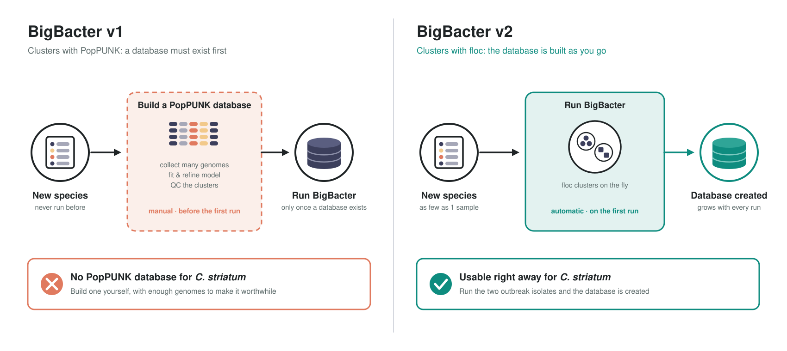
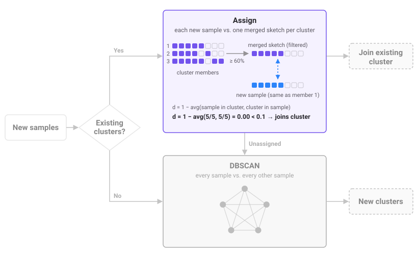
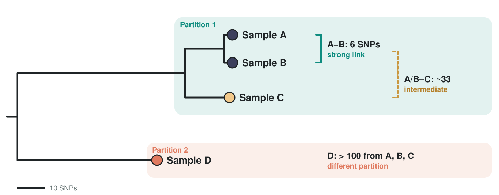

<!--
PRESENTER SETUP
- Browser (this deck) on one side, terminal on the other, `cd bigbacter-demo`.
- Start clean: rm -r results bigbacter_db .nextflow* work/
- Optional: pre-pull the pipeline so the first run doesn't wait on the download:
    nextflow pull nw-page/bigbacter -r main
- Slides tagged 💻 = switch to the terminal.
- Backup: outputs/ holds the summary CSV and .microreact report from each of the three runs.
  Drag a .microreact file onto https://microreact.org/upload to open it.
- params/params.N.yml all start with `push: false`. After reviewing each run, edit the file to
  `push: true` and re-run with -resume.
-->

# The scenario

## A suspected outbreak

::: {.lead}
Epis reach out about a suspected ***Corynebacterium striatum*** outbreak and ask the lab to use
whole genome sequencing to investigate.
:::

::: {.organism}
{.organism-icon fig-alt="Simplified drawing of club-shaped Corynebacterium rods"}

::: {.organism-text}
**About *C. striatum***

Skin and mucosal commensal, increasingly recognized as a multidrug-resistant,
healthcare-associated pathogen.
:::
:::

- Two isolates from the suspected outbreak have been sequenced: **sim01** and **sim02**
- The question: **are they genomically related?**

::: {.notes}
The isolates in this demo are simulated from a public C. striatum genome
(sim01 = 10 SNPs, sim02 = 1 SNP, sim03 = 0 SNPs; see simulated/manifest.tsv).
:::

## Run samples through BigBacter
<!--
Include the bigbacter logo that is in the logos dir. Have this first slide show the SVG of how BBv1 works, where a PopPUNK database is needed. I will show the poppunk database website that does not have one - this means we have to create one now. Then go to the next slide which introduces BBv2 which now creates these databases for you using Floc.
-->
- Our lab already runs BigBacter routinely, but we've **never analyzed *C. striatum*** before
- A new species needs **its own BigBacter database**, so we have to establish one
- BigBacter v1 clustered with **PopPUNK**, which needs a database built for the species
- Check what's available: [bacpop.org/poppunk-databases](https://bacpop.org/poppunk-databases/){target="_blank"}.
  There is **no *C. striatum* database**

. . .

::: {.box .accent title="BigBacter v2"}
- Clusters with **floc**, so no PopPUNK database is needed
- The database is **created on the first run**, from as few as **1 sample**
:::

::: {.fragment .click-overlay}
{fig-alt="BigBacter v1 needs a PopPUNK database built before the first run; BigBacter v2 clusters with floc and creates its database automatically"}
:::

::: {.notes}
Third click shows the v1 vs v2 diagram over the slide.
Optional: open the PopPUNK database page and scroll the species list.
v1 databases aren't compatible with v2.
:::

# Run 1: the outbreak isolates

## 1. Getting started with BigBacter
<!--
The formatting is not quite right here. Move it all to an SVG if needed. Also remove the note about not needing to clone the repo.
-->

:::: {.setup-grid}
::: {.setup-step}
[1]{.step-num} **Install Nextflow**

{.logo-wide fig-alt="Nextflow logo"}

Version **≥ 25.04**, which needs Java 17+

```bash
curl -s https://get.nextflow.io | bash
```
:::

::: {.setup-step}
[2]{.step-num} **Install a container engine**

::: {.logo-row}
{fig-alt="Docker logo"}
{.logo-podman fig-alt="Podman logo"}
{fig-alt="Apptainer logo"}
{fig-alt="Singularity logo"}
:::

Every tool runs in a container. **No Conda/Mamba**, and nothing else to install
:::

::: {.setup-step}
[3]{.step-num} **Test the install**

Runs a small bundled *E. coli* dataset

```bash
nextflow run nw-page/bigbacter \
  -r main \
  -profile test,docker
```
:::
::::

::: {.box .note .center}
**No need to clone the repo.** Nextflow pulls `nw-page/bigbacter` from GitHub when you run it.
:::

## 2. Create the samplesheet

<!--
update this to be a CSV code block. 
-->

| sample | taxa | assembly | fastq_1 | fastq_2 |
|---|---|---|---|---|
| sim01 | Corynebacterium striatum | …/sim01.fasta.gz | …/sim01_R1.fastq.gz | …/sim01_R2.fastq.gz |
| sim02 | Corynebacterium striatum | …/sim02.fasta.gz | …/sim02_R1.fastq.gz | …/sim02_R2.fastq.gz |

<br>

:::: {.columns}
::: {.column width="50%"}
::: {.box .note title="Required"}
- `sample`: a unique name
- Data: reads (`fastq_1`/`fastq_2`), **or** an `sra` / `genbank` accession that BigBacter downloads
:::
:::
::: {.column width="50%"}
::: {.box .plain title="Optional"}
- `taxa` and `assembly`: **reuse outputs from your routine pipeline**
- Skips taxonomic classification and assembly
:::
:::
::::

## 3. Configure the run: the params file

:::: {.columns}
::: {.column width="55%"}
```{.yaml filename="params/params.1.yml"}
input: samplesheets/samplesheet.1.csv
outdir: results
db: bigbacter_db/
push: false
```
:::
::: {.column width="45%"}
- `input`: path to samplesheet
- `outdir`: results for this run
- `db`: path to BigBacter database
- `push: false`: this will be updated later!
:::
::::

::: {.box .accent title="Tip"}
**Params files** (or config) are recommended for newer version of Nextflow!
:::

## 4. Run BigBacter

```bash
nextflow run nw-page/bigbacter \
    -r main \
    -profile docker,pc \
    -params-file params/params.1.yml
```

::: {.box .plain .center}
⏱ Should take about 3 mins to complete
:::

# While that's running…

## How BigBacter works

{fig-align="center" width="100%" fig-alt="BigBacter pipeline: samplesheet, input prep, cluster with floc, select reference, core SNPs, tree, report; the database supplies existing clusters, references and historic samples and receives results on push"}

::: {.notes}
Reference: https://nw-page.github.io/bigbacter-docs/docs/v2.0/pages/overview/
Input prep is dashed: it only runs for what's missing (e.g. no assembly or no taxa in the samplesheet).
:::

## Clustering with floc

<!--
The logo is tiny and not aligned correctly. The SVG diagram has most of the clustering approach greyed out. Focus on how floc was designed as a more flexible alternative to PopPUNK - samples can be removed and only a single sample is needed to start a database. Keep it simple. Use the floc_vs_poppunk.svg as an example.
-->

{.floc-logo fig-alt="floc logo"}

:::: {.columns}
::: {.column width="62%"}
{width="100%" fig-alt="floc assigns new samples to existing clusters using one merged sketch per cluster, and clusters unassigned samples with DBSCAN"}
:::
::: {.column width="38%" .floc-text}
- Uses **sourmash** sketches to group samples *within a species*
- **Existing clusters:** each new sample is compared with one merged sketch per cluster
  (hashes in ≥ 60% of members) and joins if within `0.1`
- **Everything else** (or every sample, on the first run) is clustered with **DBSCAN**
- Clusters are coarse bins, not outbreak calls
:::
::::

::: {.notes}
Diagram from the BigBacter docs (floc blog post). Defaults (v2.2.0): --clust_dist 0.1, --clust_assign_hashfreq 0.6.
Code: https://github.com/nw-page/floc
:::

## Core SNPs and linkage

<!--
Integrate the linkage and partition definitions into the tree SVG. Discuss the soft-core genome threshold on another slide using the polycore_one_tool.svg and the core-genome-define-example.png as examples for how to structure the content. The idea that the new version uses a new tool, Polycore to call the softcore genome. Simplify this to a single SVG if possible.
-->

{fig-align="center" width="88%" fig-alt="Tree where samples A and B are 6 SNPs apart (strong link), C is about 33 SNPs from them (intermediate link), and D is more than 100 SNPs away in a different partition"}

:::: {.columns .linkage-row}
::: {.column width="42%"}
| Link | Default |
|---|---|
| **Strong** | ≤ 10 SNPs |
| **Intermediate** | ≤ 50 SNPs |
| **Partition** | ≤ 100 subs |
:::
::: {.column width="58%"}
- One reference per cluster, **reused every run**
- Soft-core alignment: sites in **≥ 90%** of samples
- Samples already in the database **aren't re-mapped**
:::
::::

::: {.notes}
Parameters: --strong_link_threshold, --inter_link_threshold, --partition_distance, --min_core_fraction.
These are BigBacter defaults, not outbreak definitions for C. striatum. Agree on thresholds with epis.
:::

# Run 1 results

## 5. Check the results 💻

<!--
Include basic numbered steps for what we will do - open summary, look at microreact report
-->

## 6. Push the samples

We're happy with these results. Set `push: true` and re-run with `-resume`:

:::: {.columns .push-row}
::: {.column width="50%"}
```{.yaml filename="params/params.1.yml"}
input: samplesheets/samplesheet.1.csv
outdir: results
db: bigbacter_db/
push: true
```
:::
::: {.column width="50%"}
```bash
nextflow run nw-page/bigbacter -r main \
  -profile docker,pc \
  -params-file params/params.1.yml \
  -resume
```
:::
::::

- `-resume` reuses the cached work, so **nothing is recomputed**. The results are just written to
  the database
- The *C. striatum* database now exists, built from **2 samples**

## The database grows with every run

{fig-align="center" width="100%" fig-alt="Three runs each push into the C. striatum database, which grows from 2 to 5 to 6 samples; each run is compared against everything already in the database"}

::: {.notes}
This is the arc of the rest of the demo: run 1 (outbreak isolates), run 2 (NCBI context + epi request),
run 3 (one new isolate).
:::

# Run 2: adding context

## Challenge 2: is this only local?

- Are our isolates related to anything **outside our lab**?
- Find public *C. striatum* genomes to add as context, e.g. from
  [NCBI Pathogen Detection](https://www.ncbi.nlm.nih.gov/pathogens/){target="_blank"}
- An epi has also asked about one more genome (**Dan_Request**). Is it part of this?

::: {.notes}
Optional: open NCBI Pathogen Detection and show where the accessions came from.
:::

## Context samplesheet: just accessions

```{.csv filename="samplesheets/samplesheet.2.csv"}
sample,taxa,genbank
GCA_016085355_1,Corynebacterium striatum,GCA_016085355.1
GCA_002804085_1,Corynebacterium striatum,GCA_002804085.1
Dan_Request,Corynebacterium striatum,GCA_015946805.1
```

- No files to download yourself: **BigBacter pulls the assemblies from NCBI**
- Run 1 samples **aren't listed**. They're already in the database

## Run 2 💻

```bash
nextflow run nw-page/bigbacter -r main \
  -profile docker,pc \
  -params-file params/params.2.yml
```

::: {.notes}
~2 min. While it runs, recap: floc will place these against cluster 1 from the database.
:::

<!--
Move core genome slides here
-->

## Run 2 results

| id | status | cluster | strong links | SNPs (min–max) |
|---|---|---|---|---|
| GCA_002804085_1 | new | 1 | GCA_016085355_1, sim01, sim02, Reference_sim02 | 1–10 |
| GCA_016085355_1 | new | 1 | GCA_002804085_1 | 10–20 |
| sim01 | old | 1 | GCA_002804085_1 | 10–20 |
| sim02 | old | 1 | GCA_002804085_1, Reference_sim02 | 1–11 |
| **Dan_Request** | new | **2** | – | – |

- **GCA_002804085_1** is **1 SNP** from sim02: a public genome closely linked to our outbreak
- **Dan_Request** forms its own **cluster 2**, with its own reference → **not related**

::: {.notes}
Backup: outputs/1795625861-summary.csv and the matching .microreact.
Point out: sim01/sim02 show status "old": they came from the database and weren't re-mapped.
Now there are enough samples for a tree in the Microreact report.
:::

## Push run 2 💻

Set `push: true` in `params/params.2.yml`, then:

```bash
nextflow run nw-page/bigbacter -r main \
  -profile docker,pc \
  -params-file params/params.2.yml \
  -resume
```

# Run 3: a new isolate

## One more isolate arrives

<!--
Add in story that multiple weeks have passed and you are now deep in a measles outbreak and get this sample.
-->

`samplesheets/samplesheet.3.csv`

| sample | taxa | assembly | fastq_1 | fastq_2 |
|---|---|---|---|---|
| sim03 | Corynebacterium striatum | …/sim03.fasta.gz | …/sim03_R1.fastq.gz | …/sim03_R2.fastq.gz |

- A **single sample** is fine. It's compared against everything in the database

```bash
nextflow run nw-page/bigbacter -r main \
  -profile docker,pc \
  -params-file params/params.3.yml
```

## Run 3 results

| id | status | cluster | SNPs (min–max) |
|---|---|---|---|
| **sim03** | **new** | 1 | **0–10** |
| GCA_002804085_1 | old | 1 | 0–10 |
| GCA_016085355_1 | old | 1 | 10–20 |
| sim01 | old | 1 | 10–20 |
| sim02 | old | 1 | 1–11 |

- sim03 joins **cluster 1** with **strong links to every member** (0 SNPs from GCA_002804085_1, 1 from sim02)
- Only cluster 1 was re-analyzed. **Cluster 2 had no new samples**
- Only sim03 was mapped. Everything else came from the database

::: {.notes}
Backup: outputs/1795625994-summary.csv and the matching .microreact.
Open the tree in Microreact: sim03, sim02 and GCA_002804085_1 sit together, sim01 and
GCA_016085355_1 on longer branches.
:::

## Push and share 💻

Set `push: true` in `params/params.3.yml`, then:

```bash
nextflow run nw-page/bigbacter -r main \
  -profile docker,pc \
  -params-file params/params.3.yml \
  -resume
```

::: {.box .accent}
Share the Microreact report and run summary with the epis.
:::

# Wrap-up

## Takeaways

- **No PopPUNK database needed**: BigBacter v2 builds one for any species, from as few as **1 sample**
- **Run → review → push** with `-resume`, so only results you've checked go into the database
- The database **grows with every run**: new samples are compared against everything before them,
  and old samples aren't reprocessed
- **Public context is just an accession** in the samplesheet
- Separate clusters are an answer too: **Dan_Request is not part of this outbreak**

## Resources

- Docs: [nw-page.github.io/bigbacter-docs](https://nw-page.github.io/bigbacter-docs/){target="_blank"}
- Code: [github.com/nw-page/bigbacter](https://github.com/nw-page/bigbacter){target="_blank"}
- floc: [github.com/nw-page/floc](https://github.com/nw-page/floc){target="_blank"}
- Demo files: [github.com/waphl-bioinformatics/presentations](https://github.com/waphl-bioinformatics/presentations/tree/main/bigbacter-demo){target="_blank"}

## Questions?
